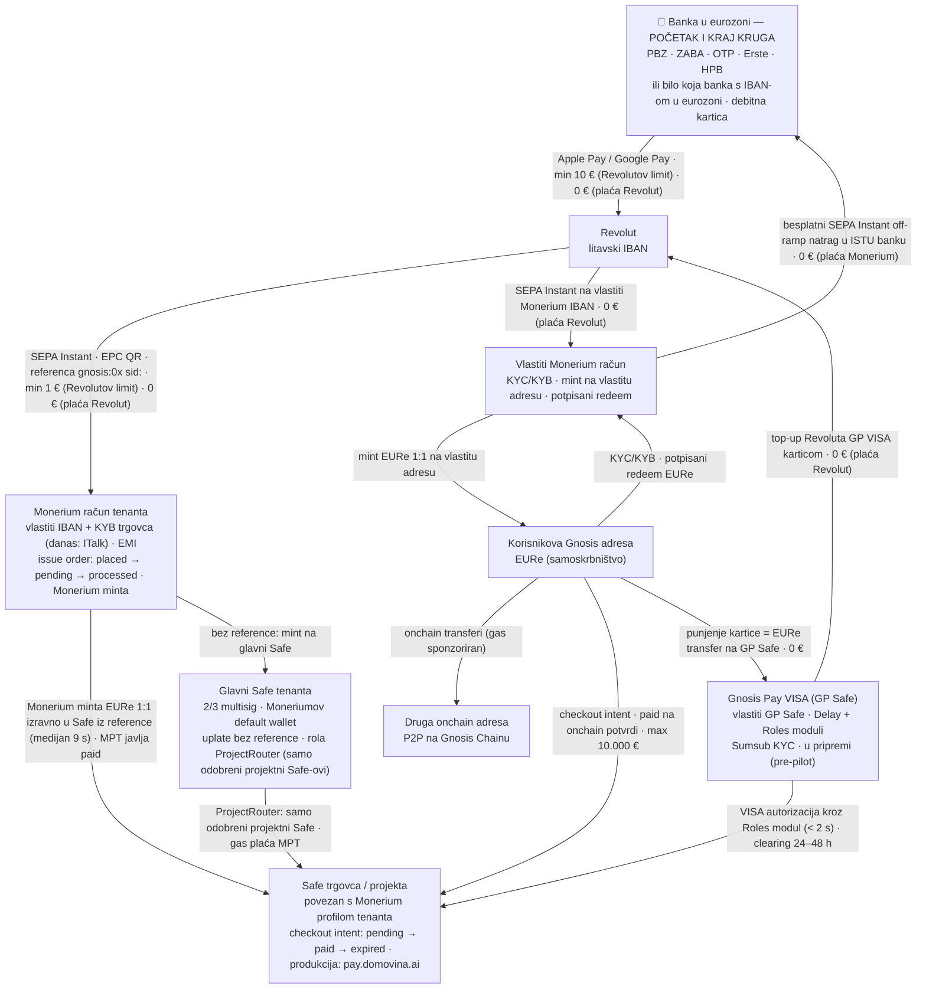

# MPT — dokumentirani tok novca / documented money flow

Izvor istine za graf i prijelaze je [`src/lib/mpt-machine.ts`](../src/lib/mpt-machine.ts) —
iz njega se generiraju React Flow vizualizacija, simulacije na landingu i vitest testovi.
Model je verificiran protiv referentne implementacije i njezine dokumentacije:

- `pay.domovina.ai/docs/monerium-private.md` — Monerium Private API single source of truth
- `pay.domovina.ai/docs/plans/gnosis-pay-cards/` — Gnosis Pay plan integracije (pre-pilot)
- `pay.domovina.ai/backend/` — worker `pay-domovina-backend`: Monerium webhook receiver,
  referenca (`tenants/rail.ts`, parser `monerium/sid.ts`), direct gate (`tenants/whitelist.ts`),
  uplate bez reference i ProjectRouter (`monerium/forward.ts`, `monerium/strayResolver.ts`),
  checkout intenti (`intents/`)
- `pay.domovina.ai/docs/decisions/` — ADR 0025 (router umirovljen, svi tenanti `direct`),
  0026 (ProjectRouter), 0018 (stray resolver), 0028 (kratka referenca intenta)

Ovaj dokument je Mermaid preslika istog modela.

**Pozicioniranje:** MPT je orkestrator i notification servis za više Monerium računa
(tenanata) — „RevenueCat za SEPA → EURe". Svaki trgovac ima vlastiti Monerium KYB, IBAN,
glavni Safe i projektne Safe-ove povezane s njegovim Monerium profilom. **Monerium minta,
ne MPT:** kupac plati SEPA uplatu s referencom `gnosis:0x<Safe> sid:<intent>`, a Monerium
minta EURe 1:1 izravno u taj Safe (način `direct`, od 15. 10. 2026., ADR 0025). MPT uplatu
uparuje s intentom i javlja je (zaprimljeno → paid, potpisani webhook s outboxom, SSE,
potvrda o uplati). MPT nema ključ koji može pomaknuti novac izvan skupa Safe-ova koje su
vlasnici odobrili. Uplata bez reference (Revolut nakon skeniranja QR-a briše opis) minta se
na glavni Safe tenanta; stray resolver je veže uz intent po iznosu i vremenu ili kratkom
kodu, a rola ProjectRouter (ADR 0026) je prosljeđuje samo na odobreni projektni Safe
(Zodiac Roles `Or(EqualTo…)` na lancu, bez kapice na iznos). Forwarda na proizvoljnu
korisnikovu adresu više nema: vlastiti wallet se puni preko vlastitog Monerium računa.
Multi-tenant rail je uključen (`MULTI_TENANT_RAIL = "1"`, tenanti u D1); jedini tenant s
pravim novcem je zasad ITalk d.o.o. (glavni Safe `0x449a…`, 2/3).

## Usmjereni graf toka novca

## State machine (prijelazi procesa)

```mermaid
stateDiagram-v2
    [*] --> FUNDS_AT_BANK
    FUNDS_AT_BANK --> FUNDS_AT_REVOLUT : cardTopup (min 10 € Revolut, plaća Revolut)
    FUNDS_AT_REVOLUT --> FUNDS_AT_REVOLUT : scanEpcQr
    FUNDS_AT_REVOLUT --> FUNDS_AT_REVOLUT : confirmAllowlist
    FUNDS_AT_REVOLUT --> FUNDS_AT_REVOLUT : revolutInternalCheck
    FUNDS_AT_REVOLUT --> FUNDS_AT_MONERIUM_MPT : sepaToMonerium (min 1 € Revolut, referenca gnosis#colon;0x<Safe> sid#colon;<intent>)
    FUNDS_AT_REVOLUT --> FUNDS_AT_MONERIUM_MPT : sepaNoReference (prazan memo — Revolut ga nakon QR-a često ispusti)
    FUNDS_AT_MONERIUM_MPT --> FUNDS_AT_MONERIUM_MPT : checkoutReceived (order.created → „zaprimljeno" preko SSE, 0 s od placedAt)
    FUNDS_AT_MONERIUM_MPT --> FUNDS_AT_MONERIUM_MPT : moneriumVerify (issue order placed → pending → processed)
    FUNDS_AT_MONERIUM_MPT --> PAID_MERCHANT : mintEure (Monerium minta izravno u Safe iz reference; MPT na processed označi paid)
    FUNDS_AT_MONERIUM_MPT --> EURE_AT_MAIN_SAFE : mintToMainSafe (bez reference → default wallet = glavni Safe tenanta)
    EURE_AT_MAIN_SAFE --> EURE_AT_MAIN_SAFE : strayResolve (intent istog tenanta po iznosu i vremenu ili kratkom kodu)
    EURE_AT_MAIN_SAFE --> PAID_MERCHANT : forwardToPayee (ProjectRouter, Zodiac Roles na lancu, samo odobreni projektni Safe, gas plaća MPT)
    EURE_AT_MAIN_SAFE --> EURE_AT_MAIN_SAFE : strayPark (nema kandidata ili konflikt → ostaje na glavnom Safeu, alarm, forward.blocked)
    EURE_AT_MAIN_SAFE --> PAID_MERCHANT : operatorReroute (admin veže uz intent → ProjectRouter; ili 2/3 vlasnika ručno)
    PAID_MERCHANT --> PAID_MERCHANT : underpaidNotice (manja uplata — novac stigne, intent ne postaje paid, webhook payment.underpaid)
    FUNDS_AT_REVOLUT --> FUNDS_AT_OWN_MONERIUM : openMoneriumKyc + sepaToOwnMonerium (vlastiti račun; osobe od 30. 10. 2026. preko partnera)
    FUNDS_AT_OWN_MONERIUM --> EURE_AT_USER_ADDRESS : mintToOwnAddress (Monerium, 1:1)
    EURE_AT_USER_ADDRESS --> EURE_AT_OTHER_ADDRESS : onchainTransfer (gas sponzoriran)
    EURE_AT_USER_ADDRESS --> PAID_MERCHANT : payCheckoutIntent (max 10.000 €, paid na onchain potvrdi)
    EURE_AT_USER_ADDRESS --> FUNDS_AT_OWN_MONERIUM : redeemEure (potpisani nalog)
    FUNDS_AT_OWN_MONERIUM --> FUNDS_AT_BANK : sepaInstantOfframp (besplatan, plaća Monerium — ista banka s koje je krug krenuo)
    FUNDS_AT_BANK --> [*] : krug zatvoren u početnoj točki

    EURE_AT_USER_ADDRESS --> FUNDS_AT_GNOSISPAY : issueGnosisPayVisa + fundGnosisPay (EURe transfer, u pripremi)
    FUNDS_AT_GNOSISPAY --> PAID_MERCHANT : gnosisPayCardSpend (Roles spender, < 2 s)
    FUNDS_AT_GNOSISPAY --> FUNDS_AT_REVOLUT : topupRevolutFromGnosisPay (GP VISA = obična debitna kartica, 0 €)
```

## Guardovi (zaštitni limiti)

| Prijelaz | Limit | Porijeklo | Tko plaća naknadu |
|---|---|---|---|
| `cardTopup` | min 10 € | Revolutovo produktno pravilo | Revolut (kartična transakcija, marketing) |
| `sepaToMonerium` / `sepaToOwnMonerium` | min 1 € | Revolutovo produktno pravilo | Revolut (SEPA Instant) |
| `payCheckoutIntent` | > 0 € i ≤ 10.000 €, TTL zadano 15 min (60 s – 24 h) | MPT kod (`intents/api.ts`) | — |
| `mintEure` | ≤ 10.000 € (intent); Safe iz reference mora biti povezan s Monerium profilom tenanta; manjak nikad nije `paid` | Monerium + MPT kod (ADR 0025, `tenants/whitelist.ts`) | Monerium (mint besplatan) |
| `forwardToPayee` / `operatorReroute` | rola ProjectRouter smije samo `EURe.transfer` na projektne Safe-ove koje su 2/3 vlasnika odobrili (Zodiac Roles `Or(EqualTo…)` na lancu); bez kapice na iznos; simulacija prije slanja | Zodiac Roles modifier (ADR 0026) | MPT (gas za ključ role) |
| `strayResolve` | točan iznos, prozor [placedAt − 48 h, +2 min], otvoreni intenti prije isteklih, samo trusted kandidati; ili kratki kod (ADR 0028) | MPT kod (ADR 0018, `monerium/strayResolver.ts`) | — |
| `mintToOwnAddress` / `redeemEure` | redeem ≥ 15.000 € traži dokument | Monerium | Monerium (besplatno, 1:1) |
| `onchainTransfer` | 5 besplatnih dnevno po potpisniku | MPT wallet relayer | MPT (sponzorirani gas) |
| `sepaInstantOfframp` | — | — | Monerium (besplatan SEPA Instant) |
| `issueGnosisPayVisa` | virtualna besplatna, max 5; Sumsub KYC obavezan | Gnosis Pay | Gnosis Pay |
| `topupRevolutFromGnosisPay` | min 10 € (kartični top-up) | Revolutovo produktno pravilo | Revolut |
| `gnosisPayCardSpend` | dnevni limit default 350 EURe (1–8000) | Gnosis Pay Roles modul | Gnosis Pay |

**Invarijante** (dokazane u `src/lib/mpt-machine.test.ts`, `npm test`):

1. Korisnik na svakom koraku svakog scenarija plaća **0 €**.
2. Iznosi se čuvaju **1:1** — zbroj svih salda konstantan je kroz cijeli tok (nema curenja).
3. Nijedno saldo nikad ne ide u minus; guardovi (min/max) odbijaju iznose izvan limita bez pomicanja novca.
4. Nijedan prijelaz ne pomiče novac s IBAN-a ili Safea trgovca na korisnikovu adresu; glavni Safe isplaćuje samo u Safe trgovca/projekta, a gas za to plaća MPT.

## Simulacijski scenariji (N = 10)

1. **Kupac plaća trgovcu iz banke** — glavni tok: SEPA s referencom `gnosis:0x<Safe> sid:<intent>`, „zaprimljeno" odmah, Monerium minta izravno u Safe trgovca (25 €)
2. **Uplata bez reference** — isti checkout, referenca izgubljena; mint na glavni Safe, stray resolver poveže uplatu s intentom po iznosu i vremenu, ProjectRouter je proslijedi na projektni Safe (15 €)
3. **Uplata koju resolver ne može povezati** — bez reference i s drugim iznosom: parkirano na glavnom Safeu trgovca, operater ručno veže uz narudžbu (20 €)
4. **Manja uplata** — narudžba 25 €, kupac pošalje 20 €: Monerium minta u Safe trgovca, intent ne postaje `paid`, webhook `payment.underpaid`
5. **Vlastiti wallet** — banka → vlastiti Monerium račun → EURe na Gnosis adresi, bez MPT-a (10 €)
6. **Puni krug** — banka → vlastiti Monerium račun → adresa → potpisani redeem → besplatni off-ramp natrag u banku (50 € ode, 50 € se vrati)
7. **Onchain P2P** — višestruki transferi nakon punjenja walleta (sponzorirani gas)
8. **Checkout iz walleta** — korisnik koji već drži EURe plaća intent onchain, `paid` na onchain potvrdi
9. **Gnosis Pay VISA grana** — virtualna kartica na vlastitom GP Safeu, punjenje EURe transferom, POS plaćanje i besplatni top-up Revoluta karticom — krug se vrti dalje (u pripremi)
10. **Guardovi** — odbijanje 9,99 € top-upa i 0,50 € SEPA-e (Revolutovi limiti); u testovima i odbijanje intenta > 10.000 € (MPT guard)
