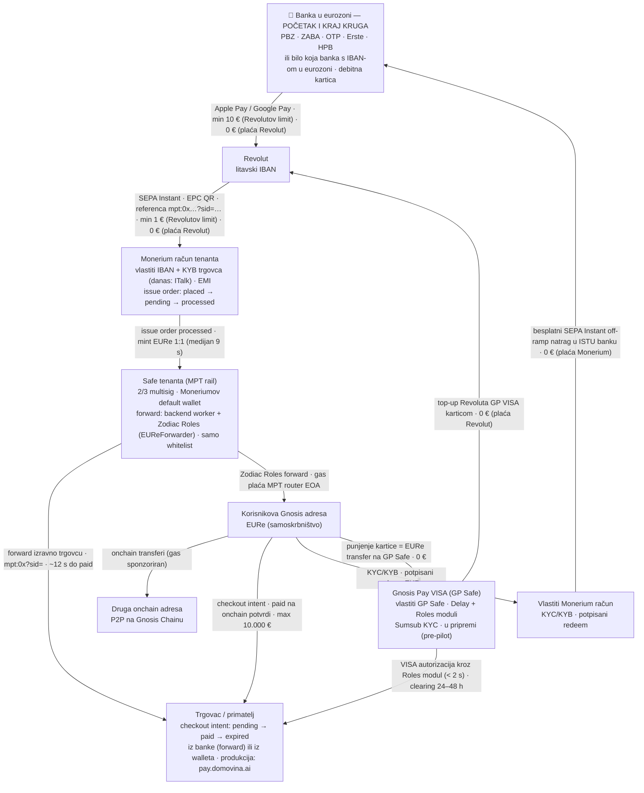

# MPT — dokumentirani tok novca / documented money flow

Izvor istine za graf i prijelaze je [`src/lib/mpt-machine.ts`](../src/lib/mpt-machine.ts) —
iz njega se generiraju React Flow vizualizacija, simulacije na landingu i vitest testovi.
Model je verificiran protiv referentne implementacije i njezine dokumentacije:

- `pay.domovina.ai/docs/monerium-private.md` — Monerium Private API single source of truth
- `pay.domovina.ai/docs/plans/gnosis-pay-cards/` — Gnosis Pay plan integracije (pre-pilot)
- `pay.domovina.ai/backend/` — worker `pay-domovina-backend`: Monerium webhook receiver,
  parser reference (`monerium/sid.ts`), Zodiac forward (`router/safe.ts`), checkout intenti (`intents/`)

Ovaj dokument je Mermaid preslika istog modela.

**Pozicioniranje:** MPT je orkestrator za više Monerium računa (tenanata) — „RevenueCat za
SEPA → EURe". Svaki trgovac ima vlastiti Monerium KYB, IBAN, Safe i payout whitelist; MPT
ne prima i ne drži novac, nego vodi poslovnu logiku (intenti, reference, routing,
webhookovi, status uživo). Glavni tok je **plaćanje trgovcu iz banke** (forward sa Safea
tenanta izravno na adresu trgovca). Multi-tenant rail (ADR 0017) je u produkcijskom kodu,
ali isključen (`MULTI_TENANT_RAIL=0`) dok prvi vanjski tenant ne završi KYB; prvi tenant
je ITalk d.o.o. (Safe `0x449a…`). Dodatni izvori: ADR 0016 (payout whitelist), 0017
(multi-tenant), 0018 (uplate bez reference, rano „zaprimljeno"), 0019 (detektor krađe).

## Usmjereni graf toka novca

## State machine (prijelazi procesa)

```mermaid
stateDiagram-v2
    [*] --> FUNDS_AT_BANK
    FUNDS_AT_BANK --> FUNDS_AT_REVOLUT : cardTopup (min 10 € Revolut, plaća Revolut)
    FUNDS_AT_REVOLUT --> FUNDS_AT_REVOLUT : scanEpcQr
    FUNDS_AT_REVOLUT --> FUNDS_AT_REVOLUT : confirmAllowlist
    FUNDS_AT_REVOLUT --> FUNDS_AT_REVOLUT : revolutInternalCheck
    FUNDS_AT_REVOLUT --> FUNDS_AT_MONERIUM_MPT : sepaToMonerium (min 1 € Revolut, referenca mpt#colon;0x…?sid=…)
    FUNDS_AT_MONERIUM_MPT --> FUNDS_AT_MONERIUM_MPT : moneriumVerify (issue order placed → pending → processed)
    FUNDS_AT_MONERIUM_MPT --> EURE_AT_MAIN_RAIL_SAFE : mintEure (1:1, na default wallet)
    EURE_AT_MAIN_RAIL_SAFE --> EURE_AT_USER_ADDRESS : relaySponsoredTx (Zodiac Roles, router EOA plaća gas)
    FUNDS_AT_REVOLUT --> FUNDS_AT_MONERIUM_MPT : sepaNoReference (prazan memo — Revolut iOS ga ponekad ispusti)
    FUNDS_AT_MONERIUM_MPT --> FUNDS_AT_MONERIUM_MPT : checkoutReceived (order.created → „zaprimljeno" preko SSE, 0 s od placedAt)
    EURE_AT_MAIN_RAIL_SAFE --> PAID_MERCHANT : forwardToPayee (referenca mpt#colon;0x<trgovac>?sid, whitelist, paid na onchain potvrdi)
    EURE_AT_MAIN_RAIL_SAFE --> EURE_AT_MAIN_RAIL_SAFE : strayResolve (bez reference → intent istog tenanta po iznosu i vremenu; nejednoznačno → parkirano)
    EURE_AT_USER_ADDRESS --> EURE_AT_OTHER_ADDRESS : onchainTransfer (gas sponzoriran)
    EURE_AT_USER_ADDRESS --> PAID_MERCHANT : payCheckoutIntent (max 10.000 €, paid na onchain potvrdi)
    EURE_AT_USER_ADDRESS --> FUNDS_AT_OWN_MONERIUM : openMoneriumKyc + redeemEure (potpisani nalog)
    FUNDS_AT_OWN_MONERIUM --> FUNDS_AT_BANK : sepaInstantOfframp (besplatan, plaća Monerium — ista banka s koje je krug krenuo)
    FUNDS_AT_BANK --> [*] : krug zatvoren u početnoj točki

    EURE_AT_USER_ADDRESS --> FUNDS_AT_GNOSISPAY : issueGnosisPayVisa + fundGnosisPay (EURe transfer, u pripremi)
    FUNDS_AT_GNOSISPAY --> PAID_MERCHANT : gnosisPayCardSpend (Roles spender, < 2 s)
    FUNDS_AT_GNOSISPAY --> FUNDS_AT_REVOLUT : topupRevolutFromGnosisPay (GP VISA = obična debitna kartica, 0 €)
```

## Guardovi (zaštitni limiti)

| Prijelaz | Limit | Porijeklo | Tko plaća naknadu |
|---|---|---|---|
| `cardTopup` | min 10 € | Revolutovo produktno pravilo | Revolut (kartična transakcija, marketing) |
| `sepaToMonerium` | min 1 € | Revolutovo produktno pravilo | Revolut (SEPA Instant) |
| `payCheckoutIntent` | > 0 € i ≤ 10.000 €, TTL zadano 15 min (60 s – 24 h) | MPT kod (`intents/api.ts`) | — |
| `forwardToPayee` | ≤ 10.000 € (intent); samo whitelist tenanta (fail-closed); manjak nikad nije `paid` | MPT kod (ADR 0016, `intents/`) | MPT (router EOA plaća gas) |
| `strayResolve` | točan iznos, prozor [placedAt − 48 h, +2 min], otvoreni intenti prije isteklih, samo trusted kandidati | MPT kod (ADR 0018, `monerium/strayResolver.ts`) | — |
| `mintEure` / `redeemEure` | redeem ≥ 15.000 € traži dokument | Monerium | Monerium (besplatno, 1:1) |
| `relaySponsoredTx` | rola smije samo `EURe.transfer`; samo whitelist tenanta | MPT kod (Zodiac rola) | MPT (router EOA plaća gas) |
| `onchainTransfer` | 5 besplatnih dnevno po potpisniku | MPT wallet relayer | MPT (sponzorirani gas) |
| `sepaInstantOfframp` | — | — | Monerium (besplatan SEPA Instant) |
| `issueGnosisPayVisa` | virtualna besplatna, max 5; Sumsub KYC obavezan | Gnosis Pay | Gnosis Pay |
| `topupRevolutFromGnosisPay` | min 10 € (kartični top-up) | Revolutovo produktno pravilo | Revolut |
| `gnosisPayCardSpend` | dnevni limit default 350 EURe (1–8000) | Gnosis Pay Roles modul | Gnosis Pay |

**Invarijante** (dokazane u `src/lib/mpt-machine.test.ts`, `npm test`):

1. Korisnik na svakom koraku svakog scenarija plaća **0 €**.
2. Iznosi se čuvaju **1:1** — zbroj svih salda konstantan je kroz cijeli tok (nema curenja).
3. Nijedno saldo nikad ne ide u minus; guardovi (min/max) odbijaju iznose izvan limita bez pomicanja novca.

## Simulacijski scenariji (N = 8)

1. **Kupac plaća trgovcu iz banke** — glavni tok: SEPA s referencom `mpt:0x<trgovac>?sid=…`, „zaprimljeno" odmah, forward sa Safea izravno trgovcu (25 €)
2. **Uplata bez reference** — isti checkout, referenca izgubljena; stray resolver poveže uplatu s intentom po iznosu i vremenu (15 €)
3. **On-ramp** — banka → EURe na Gnosis adresi (10 €)
4. **Puni krug** — banka → … → potpisani redeem → besplatni off-ramp natrag u banku (50 € ode, 50 € se vrati)
5. **Onchain P2P** — višestruki transferi nakon on-rampa (sponzorirani gas)
6. **Checkout iz walleta** — korisnik koji već drži EURe plaća intent onchain, `paid` na onchain potvrdi
7. **Gnosis Pay VISA grana** — virtualna kartica na vlastitom GP Safeu, punjenje EURe transferom, POS plaćanje i besplatni top-up Revoluta karticom — krug se vrti dalje (u pripremi)
8. **Guardovi** — odbijanje 9,99 € top-upa i 0,50 € SEPA-e (Revolutovi limiti); u testovima i odbijanje intenta > 10.000 € (MPT guard)
